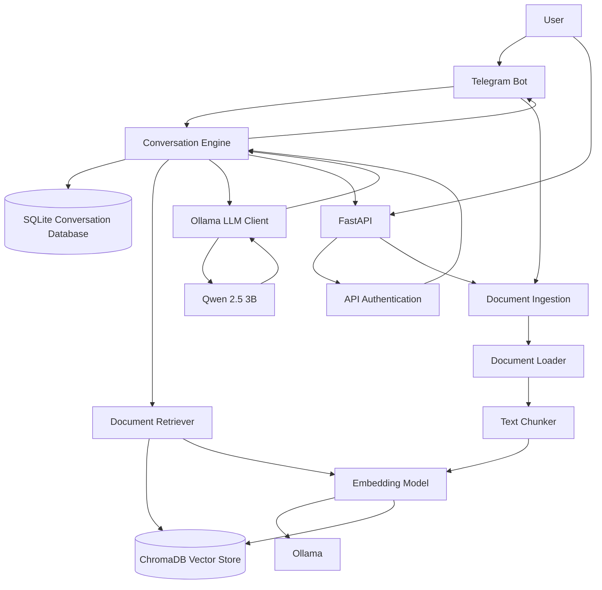

<div align="center">

# AtlasGPT


### Your documents. Your AI. Your knowledge.

AtlasGPT is a local-first AI assistant that lets users upload documents, ask questions about their content, and interact with a locally hosted language model through a browser interface, Telegram, or a REST API.

[Repository](https://github.com/chanura-madushan/AtlasGPT) · [Report a bug](https://github.com/chanura-madushan/AtlasGPT/issues)

</div>

---

## Overview

**AtlasGPT** is an AI-powered document assistant built using Python, Ollama, and open-source technologies.

It combines Retrieval-Augmented Generation (RAG) with conversation memory to help users interact with their own documents.

Users can:

- Upload PDF, TXT, and DOCX documents.
- Ask questions about uploaded documents.
- Retrieve relevant document passages using semantic search.
- Maintain separate conversation histories.
- Use the authenticated browser API for the web interface.
- Interact through a Telegram bot.
- Access functionality through an authenticated REST API.

AtlasGPT uses Ollama for local language model inference and ChromaDB for persistent vector storage.

The project is designed to make document-based AI accessible while providing practical experience with LLMs, RAG, backend development, databases, and application security.

> **Project status:** Backend development is ongoing. The repository includes browser authentication, conversation management, and persistent asynchronous ingestion. Production launch still requires external infrastructure, backups, monitoring, and workload validation.

## Features

| Feature | Description |
|---|---|
| Local LLM inference | Generate responses using locally hosted Ollama models. |
| Web authentication | Register, log in, and use browser sessions. |
| Conversation management | List, view, and delete conversation histories. |
| Telegram chatbot | Interact with AtlasGPT through Telegram. |
| REST API | Access AtlasGPT through FastAPI. |
| Document uploads | Upload PDF, TXT, and DOCX files. |
| Document processing | Extract text and split documents into manageable chunks. |
| Semantic search | Generate embeddings and retrieve relevant document passages. |
| Vector storage | Store document embeddings persistently using ChromaDB. |
| RAG | Generate answers using retrieved document context. |
| Conversation memory | Maintain separate conversation histories. |
| User isolation | Keep document retrieval and API data scoped to individual users. |
| Conversation reset | Clear a user's stored conversation history through Telegram `/reset`. |
| API authentication | Protect API endpoints using bearer API keys. |
| Rate limiting | Limit authenticated API requests to 30 requests per user per 60 seconds. |
| Credential revocation | Revoke an API credential through the REST API. |
| Queued ingestion | Persist upload jobs and process them with a separate worker. |
| Automated testing | Test core functionality using pytest. |

## Architecture

AtlasGPT separates its interface, API, conversation engine, document-processing pipeline, and storage systems.



### Document processing workflow

1. A user uploads a supported document.
2. AtlasGPT extracts its text.
3. The extracted content is divided into smaller chunks.
4. An embedding model converts the chunks into numerical vectors.
5. ChromaDB stores the vectors and associated document metadata.
6. When a user asks a question, AtlasGPT generates a query embedding.
7. The retriever searches for relevant document chunks belonging to that user.
8. Retrieved context is passed to the language model.
9. Ollama generates an answer using the question, conversation history, and retrieved context.

### Conversation workflow

1. A user sends a message through Telegram or the REST API.
2. The conversation engine retrieves recent messages for that user and conversation.
3. AtlasGPT searches for relevant document context.
4. The prompt is constructed and sent to Ollama.
5. The generated response is returned to the user.
6. Successful user and assistant messages are saved in SQLite.

AtlasGPT also includes prompt-injection defenses. Retrieved document content is treated as untrusted information rather than instructions.

## Technology stack

| Technology | Purpose |
|---|---|
| Python | Main programming language |
| Ollama | Local LLM and embedding inference |
| Qwen 2.5 3B | Default language model |
| nomic-embed-text | Default embedding model |
| FastAPI | REST API framework |
| python-telegram-bot | Telegram integration |
| ChromaDB | Persistent vector database |
| SQLite | Conversation and API credential storage |
| Pydantic | Request validation |
| pytest | Automated testing |

## Project structure

```text
AtlasGPT/
│
├── data/
│   ├── uploads/
│   ├── chroma/
│   └── atlasgpt.db
│
├── src/
│   ├── api/
│   │   └── main.py
│   │
│   ├── bot/
│   │   └── telegram_bot.py
│   │
│   ├── database/
│   │   ├── __init__.py
│   │   └── conversation_db.py
│   │
│   ├── llm/
│   │   ├── __init__.py
│   │   ├── conversation_engine.py
│   │   └── ollama_client.py
│   │
│   └── rag/
│       ├── __init__.py
│       ├── chunker.py
│       ├── document_loader.py
│       ├── embeddings.py
│       ├── ingest.py
│       ├── retriever.py
│       └── vector_store.py
│
├── tests/
│   ├── test_api.py
│   ├── test_chunking.py
│   ├── test_conversation_db.py
│   ├── test_conversation_engine.py
│   ├── test_document_loader.py
│   ├── test_embeddings.py
│   ├── test_ollama.py
│   ├── test_retriever.py
│   ├── test_telegram_bot.py
│   └── test_vector_store.py
│
├── .env
├── .gitignore
├── requirements.txt
└── README.md
```

## Getting started

### Prerequisites

Install the following:

- Python 3.13 or compatible version.
- Git.
- [Ollama](https://ollama.com/download).
- A Telegram bot token if you intend to use the Telegram interface.

Your computer needs sufficient memory and storage for the language and embedding models.

### 1. Clone the repository

```bash
git clone https://github.com/chanura-madushan/AtlasGPT.git
cd AtlasGPT
```

### 2. Create a virtual environment

**Windows PowerShell**

```powershell
python -m venv .venv
.venv\Scripts\Activate.ps1
```

**macOS / Linux**

```bash
python -m venv .venv
source .venv/bin/activate
```

### 3. Install dependencies

```bash
python -m pip install -r requirements.txt
```

### 4. Install Ollama models

Start Ollama and download the default language model:

```bash
ollama pull qwen2.5:3b
```

Download the embedding model:

```bash
ollama pull nomic-embed-text
```

Check installed models:

```bash
ollama list
```

AtlasGPT uses these defaults:

| Environment variable | Default |
|---|---|
| `OLLAMA_URL` | `http://localhost:11434` |
| `OLLAMA_MODEL` | `qwen2.5:3b` |
| `OLLAMA_EMBEDDING_MODEL` | `nomic-embed-text` |

### 5. Configure environment variables

Create a `.env` file in the project root:

```dotenv
TELEGRAM_BOT_TOKEN=your_telegram_bot_token

OLLAMA_URL=http://localhost:11434
OLLAMA_MODEL=qwen2.5:3b
OLLAMA_EMBEDDING_MODEL=nomic-embed-text
```

For Telegram access:

1. Open Telegram.
2. Find [@BotFather](https://t.me/BotFather).
3. Create a bot.
4. Copy its token into `TELEGRAM_BOT_TOKEN`.

Keep your `.env` file private.

**Never commit bot tokens, API credentials, or other secrets to GitHub.**

## Using AtlasGPT

### Telegram interface

Start the Telegram bot:

```powershell
python -m src.bot.telegram_bot
```

Open your bot in Telegram and send:

```text
/start
```

Available commands:

| Command | Description |
|---|---|
| `/start` | Start interacting with AtlasGPT. |
| `/reset` | Clear your stored conversation history. |

You can also:

- Send ordinary text messages.
- Upload supported PDF, TXT, and DOCX documents.
- Ask questions about uploaded documents.
- Continue conversations using previous context.

Keep the bot process running while using it.

### REST API

Start the FastAPI server:

```powershell
python -m uvicorn src.api.main:app --reload
```

The API is available at:

```text
http://127.0.0.1:8000
```

Interactive documentation:

- Swagger UI: `http://127.0.0.1:8000/docs`
- ReDoc: `http://127.0.0.1:8000/redoc`

### API authentication

All API endpoints except the root health check require a valid bearer API key.

Example:

```http
Authorization: Bearer YOUR_API_KEY
```

API credentials are stored as SHA-256 hashes rather than plaintext keys.

**Credential provisioning:** The database includes an internal credential creation function, but V1 does not currently expose a public registration or API-key creation endpoint. API credentials must be provisioned through the application's internal process.

### Available endpoints

| Method | Endpoint | Description |
|---|---|---|
| GET | `/` | Check API availability. |
| POST | `/chat` | Send a message to AtlasGPT. |
| POST | `/documents/upload` | Upload and index a document. |
| GET | `/documents` | List your uploaded documents. |
| DELETE | `/documents/{filename}` | Delete one of your documents. |
| DELETE | `/credentials` | Revoke your current API credential. |

### Chat request

`POST /chat`

Example JSON:

```json
{
  "message": "Explain this document.",
  "conversation_id": "my-study-session"
}
```

Example successful response:

```json
{
  "reply": "Based on the uploaded document..."
}
```

Each conversation should use a consistent conversation ID to maintain its conversation history.

### Upload a document

Synchronous indexing: `POST /documents/upload`.

Queued indexing: `POST /documents/upload-async` returns HTTP 202 and a job ID. Run `python -m src.workers.ingestion_worker`, then poll `GET /documents/jobs/{job_id}`. The API and worker must share the jobs database, uploaded files, and ChromaDB data directory.

`POST /documents/upload`

Use multipart form data with the field name:

```text
file
```

Supported formats:

- PDF
- TXT
- DOCX

Maximum upload size: **10 MB**.

The API returns the filename and number of indexed chunks after successful processing.

### List documents

`GET /documents`

Returns the documents belonging to the authenticated user.

### Delete a document

`DELETE /documents/{filename}`

Deletes the selected document and its associated vector-store entries.

### Revoke an API credential

`DELETE /credentials`

Revokes the API key associated with the authenticated user.

Once revoked, that credential can no longer authenticate API requests.

## Security and limitations

AtlasGPT includes several security controls:

- Bearer API key authentication.
- SHA-256 hashing of stored API credentials.
- Per-user document and conversation isolation.
- API rate limiting.
- Upload extension validation.
- A 10 MB upload limit.
- Filename sanitization and path traversal protection.
- Generic error responses for sensitive API operations.
- Prompt-injection defenses for retrieved document content.

### Current limitations

AtlasGPT V1 is not yet intended to be exposed as an unrestricted public service.

Important limitations include:

- API credential creation is not exposed through a public endpoint.
- Rate limiting uses in-memory storage and resets when the API process restarts.
- The rate limiter is not shared between multiple application workers.
- Production-grade deployment, monitoring, and operational controls are still required.
- Telegram messages and uploaded documents pass through Telegram's infrastructure when using the Telegram interface.
- Local Ollama inference does not guarantee complete privacy across every part of the application.

Do not expose the development server directly to the public internet.

## Running tests

AtlasGPT uses pytest for automated testing.

Run the complete test suite:

```powershell
python -m pytest
```

Run tests with detailed output:

```powershell
python -m pytest -v
```

The tests cover:

- API authentication and endpoints.
- Request validation and rate limiting.
- Document upload and deletion.
- Conversation database operations.
- User and conversation isolation.
- Document loading and text chunking.
- Embedding generation.
- Vector storage and retrieval.
- Conversation processing.
- Ollama responses and error handling.
- Telegram commands and message handling.

**Continuous integration:** GitHub Actions runs the backend pytest suite on pushes and pull requests. Run `python -m pytest -v` locally against the latest branch before merging.

## Roadmap

Potential improvements after V1:

- [ ] Move production persistence to PostgreSQL and shared object storage.
- [ ] Replace the single-host SQLite ingestion queue with a managed distributed queue for multi-host deployments.
- [ ] Add plan entitlements, usage accounting, and payment-provider integration.
- [ ] Add operational metrics, alerting, backups, and restore automation.
- [ ] Complete load, security, and recovery testing before public launch.

These are future improvements, not claims about completed V1 functionality.

## Contributing

Contributions and suggestions are welcome.

1. Fork the repository.
2. Create a feature branch.
3. Make a focused change.
4. Run the automated tests.
5. Submit a pull request.

For significant changes, open an issue first to discuss the proposed implementation.

---

<div align="center">

**AtlasGPT**

Built with Python, Ollama, and open-source technologies.

[GitHub Repository](https://github.com/chanura-madushan/AtlasGPT)

</div>
