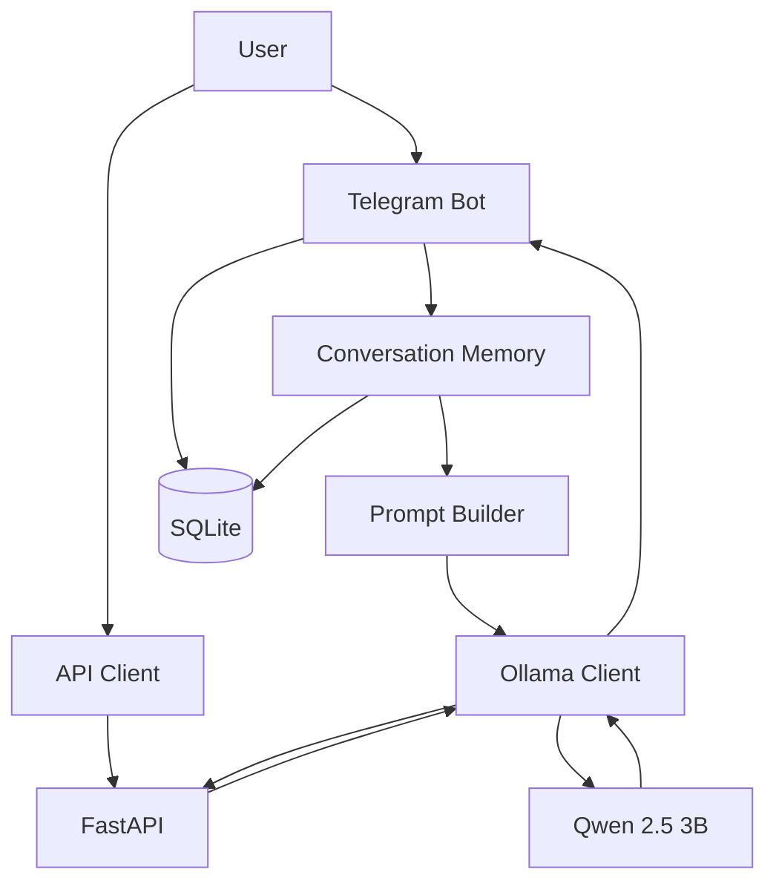

 <div align="center">

# AtlasGPT

[](https://www.python.org/)
[](https://fastapi.tiangolo.com/)
[](https://ollama.com/)
[](https://www.sqlite.org/)

### A local-first AI assistant, built from the ground up.

An experimental AI assistant project combining a locally hosted language model, a Telegram chatbot, a FastAPI backend, and persistent conversation memory.

[Explore the project](https://github.com/chanura-madushan/AtlasGPT) · [Report a bug](https://github.com/chanura-madushan/AtlasGPT/issues) · [Request a feature](https://github.com/chanura-madushan/AtlasGPT/issues)

</div>

---

## Overview

**AtlasGPT** is a hands-on project exploring how to build an AI assistant using open-source tools and locally running language models.

Instead of relying entirely on hosted AI APIs, AtlasGPT uses [Ollama](https://ollama.com/) to run a language model locally. It currently supports conversations through a Telegram bot, exposes a REST API through FastAPI, and stores conversation history in SQLite so the assistant can use previous messages when responding.

The project is actively being developed as a learning experience in backend engineering, local LLM integration, conversational memory, and AI application architecture.

> **Project status:** Working prototype. Features are being added and tested incrementally. This is not a finished production product.

## Features

| Feature | Description |
|---|---|
| Local LLM inference | Generate responses using Ollama and Qwen 2.5 3B. |
| Telegram interface | Chat with AtlasGPT through a Telegram bot. |
| Persistent memory | Store conversations in a local SQLite database. |
| Context-aware replies | Include recent conversation messages in Telegram prompts. |
| Conversation reset | Use `/reset` to clear your own stored conversation history. |
| REST API | Send messages to the assistant through FastAPI. |
| Input validation | Reject empty, whitespace-only, and oversized API messages. |
| Error handling | Handle Ollama connection failures, timeouts, and HTTP errors. |
| Automated tests | Test the API, LLM client, database operations, and Telegram handlers. |

## Architecture

AtlasGPT currently uses a modular architecture with separate components for the interface, API, language model, and persistent storage.



### How it works

1. **Input:** A user sends a message through Telegram or the REST API.
2. **Context:** The Telegram bot retrieves recent messages belonging to that user and combines them into a prompt.
3. **Inference:** The Ollama client sends the prompt to the locally running language model.
4. **Response:** The generated answer is returned to the user through the original interface.
5. **Persistence:** Successful Telegram exchanges are saved in SQLite and remain available across bot restarts.

**Important distinction:** Persistent conversation memory is currently implemented in the Telegram bot. The `/chat` API endpoint currently processes the supplied message without retrieving or storing conversation history.

## Tech stack

| Technology | Purpose |
|---|---|
| Python | Application logic |
| Ollama | Local model inference |
| Qwen 2.5 3B | Language model |
| FastAPI | REST API framework |
| python-telegram-bot | Telegram integration |
| SQLite | Persistent conversation storage |
| Pydantic | Request validation |
| pytest | Automated testing |

## Project structure

```text
AtlasGPT/
├── data/
│   ├── uploads/
│   └── atlasgpt.db
├── src/
│   ├── api/
│   │   └── main.py
│   ├── bot/
│   │   └── telegram_bot.py
│   ├── database/
│   │   ├── __init__.py
│   │   └── conversation_db.py
│   └── llm/
│       └── ollama_client.py
├── tests/
│   ├── test_api.py
│   ├── test_conversation_db.py
│   ├── test_ollama.py
│   └── test_telegram_bot.py
├── .env
├── .gitignore
├── requirements.txt
└── README.md
```

- `src/api/` — FastAPI application and HTTP endpoints.
- `src/bot/` — Telegram bot commands and message handling.
- `src/database/` — SQLite initialization, message storage, history retrieval, and reset operations.
- `src/llm/` — Ollama HTTP client and error handling.
- `tests/` — Automated tests for the application's main components.
- `data/` — Local application data. The database is excluded from version control.

## Getting started

### Prerequisites

Install the following before running AtlasGPT:

- Python 3.13 or a compatible Python version.
- Git.
- [Ollama](https://ollama.com/download).
- A Telegram bot token if you want to use the Telegram interface.

A local language model requires sufficient memory and storage for your chosen model. Performance depends on your hardware.

### 1. Clone the repository

```bash
git clone https://github.com/chanura-madushan/AtlasGPT.git
cd AtlasGPT
```

### 2. Create a virtual environment

**Windows PowerShell**

```powershell
python -m venv .venv
.\.venv\Scripts\Activate.ps1
```

**macOS / Linux**

```bash
python -m venv .venv
source .venv/bin/activate
```

### 3. Install dependencies

```bash
python -m pip install -r requirements.txt
```

Install the testing dependencies as well:

```bash
python -m pip install pytest pytest-asyncio
```

### 4. Choose and download a local LLM

AtlasGPT uses `qwen2.5:3b` by default. You can try a larger or newer model for potentially better answers, depending on your computer's hardware.

**Hardware recommendations are estimates, not strict minimum requirements.** Download sizes refer to the listed Ollama versions and may change. Actual memory usage depends on the context length, quantization, and other running applications.

| Model | Approx. download size | Suggested system RAM | Suggested GPU VRAM | Best for |
|---|---:|---:|---:|---|
| [Qwen3 4B](https://ollama.com/library/qwen3:4b) — `qwen3:4b` | 2.5 GB | 8–16 GB | 4 GB | Lightweight upgrade for everyday questions |
| [Gemma 3 4B](https://ollama.com/library/gemma3:4b) — `gemma3:4b` | 3.4 GB | 8–16 GB | 4–6 GB | General chat and image understanding |
| [Qwen3 8B](https://ollama.com/library/qwen3:8b) — `qwen3:8b` | 5.2 GB | 16 GB | 8 GB | General answers, reasoning, and coding |
| [Llama 3.1 8B](https://ollama.com/library/llama3.1:8b) — `llama3.1:8b` | 4.9 GB | 16 GB | 8 GB | General-purpose text assistant |
| [Gemma 3 12B](https://ollama.com/library/gemma3:12b) — `gemma3:12b` | 8.2 GB | 24–32 GB | 12 GB | More capable chat and image understanding |
| [Qwen3 14B](https://ollama.com/library/qwen3:14b) — `qwen3:14b` | 9.3 GB | 32 GB | 16 GB | Higher-capability responses on stronger computers |

#### Which model should you choose?

- **8 GB RAM:** Start with `qwen3:4b`.
- **16 GB RAM:** Try `qwen3:8b` if it runs comfortably on your machine.
- **16 GB RAM with an 8 GB GPU:** Try `qwen3:8b` or `llama3.1:8b`.
- **32 GB RAM and a 12–16 GB GPU:** Consider `gemma3:12b` or `qwen3:14b`.

A larger model can provide better answers, but it is not automatically faster. For a faster experience, a smaller model that fits in your GPU memory may outperform a larger model running mostly on the CPU.

#### Download your chosen model

Install and start [Ollama](https://ollama.com/download), then run one of these commands in your terminal:

```bash
ollama pull qwen3:4b
```

Or choose a larger model:

```bash
ollama pull qwen3:8b
```

Other available options include `gemma3:4b`, `llama3.1:8b`, `gemma3:12b`, and `qwen3:14b`. Use the matching model tag in the `ollama pull` command.

#### Configure AtlasGPT to use the model

Open your project's `.env` file and change `OLLAMA_MODEL` to your chosen model. For example:

```dotenv
OLLAMA_MODEL=qwen3:8b
OLLAMA_URL=http://localhost:11434
```

Save the file and restart AtlasGPT. Your existing `qwen2.5:3b` model can remain installed; you can switch between installed models by changing `OLLAMA_MODEL`.

Use `ollama list` to see which models are installed.

AtlasGPT uses `qwen2.5:3b` by default. Ollama must be accessible at `http://localhost:11434` unless you configure a different endpoint.

### 5. Configure environment variables

Create a `.env` file in the project root:

```dotenv
TELEGRAM_BOT_TOKEN=your_telegram_bot_token
OLLAMA_MODEL=qwen2.5:3b
OLLAMA_URL=http://localhost:11434
```

Replace the token placeholder with your own token from Telegram's [@BotFather](https://t.me/BotFather).

Keep `.env` private. **Never commit API keys, bot tokens, or other secrets to GitHub.**

### 6. Start the Telegram bot

```powershell
python -m src.bot.telegram_bot
```

Open Telegram, find your bot, and send `/start`.

The bot supports ordinary text messages and the following command:

| Command | Action |
|---|---|
| `/start` | Start interacting with AtlasGPT. |
| `/reset` | Clear the current user's stored conversation history. |

Keep the terminal running while using the bot.

## REST API

AtlasGPT also exposes a REST API built with FastAPI.

### Start the API server

With your virtual environment activated, run:

```bash
uvicorn src.api.main:app --reload
```

The API is available at `http://127.0.0.1:8000`.

Interactive API documentation is available at:

- Swagger UI: `http://127.0.0.1:8000/docs`
- ReDoc: `http://127.0.0.1:8000/redoc`

### Available endpoints

| Method | Endpoint | Description |
|---|---|---|
| `GET` | `/` | Check whether the API is running. |
| `POST` | `/chat` | Send a message and receive an LLM response. |

### Example request

```http
POST /chat
Content-Type: application/json
```

```json
{
  "message": "Explain how a local language model works."
}
```

Example successful response:

```json
{
  "reply": "A local language model runs on your own machine..."
}
```

The exact response depends on the model's generated output.

Example using `curl`:

```bash
curl -X POST http://127.0.0.1:8000/chat \
  -H "Content-Type: application/json" \
  -d "{\"message\":\"Hello, AtlasGPT!\"}"
```

The API accepts messages between 1 and 4,000 characters and rejects blank or whitespace-only input. If Ollama cannot be reached or returns a handled error, the API responds with HTTP `503 Service Unavailable`.

## Running tests

AtlasGPT includes automated tests for its core components.

Run the complete suite from the project root:

```bash
python -m pytest -v
```

The tests cover:

- API routes and input validation.
- Successful Ollama responses and error handling.
- SQLite message storage, retrieval, and user isolation.
- Telegram conversation persistence, context handling, reset behavior, and error handling.

The current baseline is **15 passing tests**. Run the suite again after making changes to verify that existing behavior still works.

## Security and privacy

AtlasGPT is designed to support local inference, but local execution does not automatically guarantee complete privacy.

- Language-model inference is performed through your configured Ollama instance.
- Telegram conversations pass through Telegram's infrastructure.
- The API currently has no authentication or authorization layer and should not be exposed publicly without additional security controls.
- Conversation history is stored locally in SQLite and should be protected like any other personal data.
- Keep `.env` and private application data out of version control.

## Roadmap

AtlasGPT is being developed incrementally. Potential next steps include:

- [ ] Improve conversation context management and configurable history limits.
- [ ] Add document ingestion and retrieval-augmented generation (RAG).
- [ ] Explore embeddings and vector search for document retrieval.
- [ ] Add multimodal document and image understanding.
- [ ] Add stronger API authentication and security controls.
- [ ] Expand automated tests and application observability.
- [ ] Explore a more capable interface beyond Telegram.

These are planned improvements, not currently completed features.

## Contributing

Contributions, bug reports, and feature suggestions are welcome.

1. Fork the repository.
2. Create a feature branch.
3. Make a focused change.
4. Run the test suite.
5. Open a pull request explaining the change.

For significant changes, consider opening an issue first to discuss the proposed approach.

## Learning in public

AtlasGPT is a practical learning project focused on understanding how local LLMs, backend APIs, messaging platforms, and persistent memory fit together in a real application.

The aim is to build the system one component at a time, test each improvement, and document what works along the way.

---

<div align="center">

**AtlasGPT** · Built incrementally with Python and open-source AI tools.

[Repository](https://github.com/chanura-madushan/AtlasGPT) · [Issues](https://github.com/chanura-madushan/AtlasGPT/issues)

</div>
